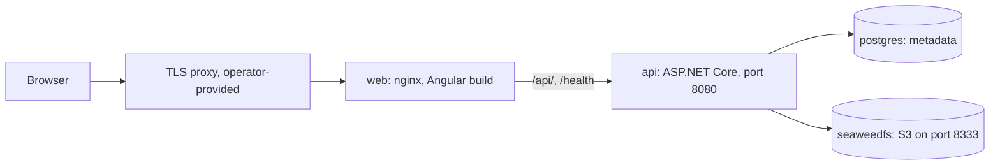
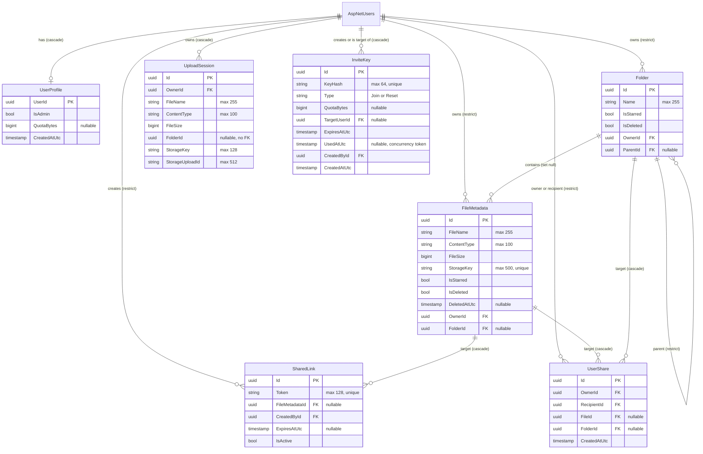

# Arcano technical documentation

For developers joining the project and for design reviewers. The code is the source of truth; paths are relative to the repository root.

Related documents, not repeated here:

- Production operations (TLS, Cloudflare Tunnel, backup, restore, upgrade): [DEPLOY.md](DEPLOY.md)
- Local setup: [backend/README.md](../backend/README.md), [README.md](../README.md)

## Contents

1. [Architecture](#1-architecture)
2. [Data model](#2-data-model)
3. [Auth and accounts](#3-auth-and-accounts)
4. [Storage](#4-storage)
5. [Sharing](#5-sharing)
6. [Background cleanup job](#6-background-cleanup-job)
7. [API reference](#7-api-reference)
8. [Rate limits](#8-rate-limits)
9. [Audit logging](#9-audit-logging)
10. [Configuration](#10-configuration)
11. [Frontend](#11-frontend)
12. [Testing](#12-testing)
13. [Known limits and shortcuts](#13-known-limits-and-shortcuts)

## 1. Architecture

### Components



| Component | Role | Source |
|---|---|---|
| `web` | Serves the Angular build, proxies `/api/` and `/health`. The only service publishing a port in production. | `frontend/nginx.conf`, `frontend/Dockerfile` |
| `api` | REST API and in-process cleanup job | `backend/src/ArcanoCore.API/` |
| `postgres` | Identity tables and all metadata | `docker-compose.prod.yml` |
| `seaweedfs` | Object storage through its S3 gateway; file bytes only | `docker-compose.prod.yml` |

In development the Angular dev server (port 4200) calls the API directly at `http://localhost:5000/api`, which is why CORS exists (`frontend/src/environments/environment.ts`). The production build uses same-origin `/api` (`environment.production.ts`, swapped through `fileReplacements` in `frontend/angular.json`). `run-dev.sh` starts postgres and seaweedfs in Docker, and the API and frontend on the host.

### Layers and dependency direction

```
ArcanoCore.API -> ArcanoCore.Infrastructure -> ArcanoCore.Application -> ArcanoCore.Domain
```

| Project | Contains | Notes |
|---|---|---|
| Domain | Entities, `BaseEntity`, `Result`/`Error`, `EmailNormalizer` | No project references. |
| Application | Services (`Services/`), DTOs (`Common/Models/`), ports (`Common/Interfaces/`) | References EF Core: services query `DbSet`s through `IApplicationDbContext`. There is no repository layer. |
| Infrastructure | `ApplicationDbContext`, EF configurations and migrations, `SeaweedStorageService`, Identity and JWT setup, `CleanupService` | Implements the ports. |
| API | Controllers, admin authorization, exception middleware, `Program.cs` | Auth and admin controllers use `UserManager` and `IApplicationDbContext` directly; `HealthController` uses `ApplicationDbContext` and `IAmazonS3` directly. |

Ports: `IApplicationDbContext`, `ICurrentUser`, `IStorageService`, `IMultipartStorage`, `IUserDirectory`.

Services return `Result` or `Result<T>` rather than throwing for expected failures (`backend/src/ArcanoCore.Domain/Common/Result.cs`). Each controller maps error codes to status codes in a small helper.

### Request flow through nginx

`frontend/nginx.conf`:

| Location | Behaviour |
|---|---|
| `/` | `try_files $uri $uri/ /index.html` (SPA fallback) |
| `= /index.html` | `Cache-Control: no-cache` |
| `~* \.(js\|css\|woff2?\|png\|jpg\|jpeg\|svg\|ico\|webp)$` | `expires 1y`, `public, immutable` (build output is content-hashed) |
| `/api/` | Proxy to `http://api:8080`; sets `X-Forwarded-For` (`$proxy_add_x_forwarded_for`, after the server-level `real_ip` step, see [other limits](#other-limits)), `X-Real-IP`, `X-Forwarded-Proto`; request and response buffering off; read and send timeouts 300 s |
| `= /health` | Proxy to the API |

Server-wide: `client_max_body_size 110m`; `X-Content-Type-Options: nosniff`, `X-Frame-Options: DENY`, `Referrer-Policy: no-referrer`. No CSP or HSTS header is set. `api` is resolved lazily through Docker DNS, so nginx can start first.

### Startup and API middleware pipeline

`backend/src/ArcanoCore.API/Program.cs`, in order at startup:

1. Migrations, when `Database:MigrateOnStartup` is true: up to 5 attempts, 2 seconds apart; the last failure aborts startup.
2. `AdminBootstrap.RunAsync` ([bootstrap rules](#bootstrap)).

Then the request pipeline, in this exact order:

| # | Middleware | Condition |
|---|---|---|
| 1 | `UseForwardedHeaders` (`XForwardedFor`, `XForwardedProto`; trusted proxies only) | Only when `ForwardedHeaders:KnownProxies` is non-empty |
| 2 | `ExceptionHandlingMiddleware` | Always |
| 3 | `UseSwagger`, `UseSwaggerUI` (at `/swagger`) | Development environment only |
| 4 | `UseCors` | Always |
| 5 | `UseAuthentication` | Always |
| 6 | `UseRateLimiter` | Always; after authentication so per-user policies can read the user id |
| 7 | `UseAuthorization` | Always |
| 8 | `MapControllers` | Always |

`ExceptionHandlingMiddleware` returns `application/problem+json` with status 500 and a generic message. It logs and writes nothing if the response has already started, and treats a client abort as a debug-level event.

Request size: Kestrel `MaxRequestBodySize` is `Storage:MaxUploadBytes` + 1 MiB for every request; `FormOptions.MultipartBodyLengthLimit` is `Storage:MaxUploadBytes`.

## 2. Data model

Entities: `backend/src/ArcanoCore.Domain/Entities/`. Configurations: `backend/src/ArcanoCore.Infrastructure/Data/Configurations/`. Users are the unchanged ASP.NET Identity `IdentityUser<Guid>` (`AspNetUsers`); group-mode data lives in `UserProfile`.



`FileMetadata`, `Folder`, `SharedLink` and `UploadSession` extend `BaseEntity<Guid>`, which adds `CreatedAtUtc`, `LastModifiedAtUtc` and `IsDeleted`.

### Soft delete and query filters

- `FileMetadata` and `Folder` have the query filter `!IsDeleted`. Code that needs trashed rows calls `IgnoreQueryFilters()`.
- `SharedLink` and `UploadSession` inherit `IsDeleted` but have no filter and nothing sets it. A link is revoked with `IsActive = false`.
- Deleting a file sets `IsDeleted`, `DeletedAtUtc` and `LastModifiedAtUtc` and keeps the object until purge. It stays visible through `GET /api/Files/trash`.
- Deleting a folder soft-deletes the folder and all live descendants, and trashes their files (`FolderService.DeleteFolderAsync`). A soft-deleted folder records its delete time in `LastModifiedAtUtc`; it has no `DeletedAtUtc`.
- There is no folder restore and no folder listing in the trash. Restoring a file whose folder is gone or soft-deleted moves it to the root (`FileService.RestoreFileAsync`).
- `ApplicationDbContext.SaveChangesAsync` sets `CreatedAtUtc` and `LastModifiedAtUtc` on `IAuditableEntity`. Changes to only `IsStarred` or `FolderId` on a file, or only `IsStarred` on a folder, do not change `LastModifiedAtUtc`, so they do not affect the "recent" view.

### Delete behaviour

| Foreign key | On delete |
|---|---|
| `FileMetadata.OwnerId`, `Folder.OwnerId`, `SharedLink.CreatedById` to user | Restrict |
| `UserShare.OwnerId`, `UserShare.RecipientId` to user | Restrict |
| `Folder.ParentId` to folder | Restrict |
| `FileMetadata.FolderId` to folder | Set null |
| `SharedLink.FileMetadataId` to file | Cascade |
| `UserShare.FileId` to file, `UserShare.FolderId` to folder | Cascade |
| `UploadSession.OwnerId`, `UserProfile.UserId` to user | Cascade |
| `InviteKey.TargetUserId`, `InviteKey.CreatedById` to user | Cascade (deleting a user removes keys they created) |

Because owner keys are Restrict, deleting a user is two steps: `AccountService.DeleteUserDataAsync` removes shares, links, files, folders and sessions and saves, then deletes objects and aborts multipart uploads (storage failures are ignored and orphan the object). The controller then deletes the user.

### Constraints and indexes

| Table | Constraint or index |
|---|---|
| `FileMetadata` | Unique `StorageKey`; indexes on `FolderId`, `OwnerId` |
| `Folder` | Unique `(OwnerId, ParentId, Name)` filtered on `"IsDeleted" = false`; index on `ParentId` |
| `SharedLink` | Unique `Token`; indexes on `CreatedById`, `FileMetadataId` |
| `UploadSession` | Index on `OwnerId` |
| `InviteKey` | Unique `KeyHash`; indexes on `CreatedById`, `TargetUserId`; `Type` stored as a string |
| `UserShare` | Check `CK_UserShare_OneTarget`: `("FileId" IS NULL) <> ("FolderId" IS NULL)`. Unique `(OwnerId, RecipientId, FileId)` filtered on `"FileId" IS NOT NULL`; unique `(OwnerId, RecipientId, FolderId)` filtered on `"FolderId" IS NOT NULL`. Indexes on `RecipientId`, `(OwnerId, FileId)`, `(OwnerId, FolderId)`, `FileId`, `FolderId` |
| `AspNetUsers` | Identity defaults: unique `NormalizedUserName`, non-unique `NormalizedEmail`. Email uniqueness comes from `RequireUniqueEmail`, not the database. |

NULLs are distinct in Postgres unique indexes, so the folder index does not cover root folders. `FolderService.ValidateLocationAsync` checks name uniqueness in code at every level, and it rejects moving a folder into itself or a descendant.

### Migrations

In `backend/src/ArcanoCore.Infrastructure/Migrations/`:

| Migration | Change |
|---|---|
| `InitialCreate` | Identity tables, files, folders, links, tags |
| `FolderUniqueLiveName` | Folder name index becomes filtered on live rows |
| `FileStarAndTrash` | File star and trash fields |
| `UploadSession` | `UploadSession` table |
| `RemoveUnusedFileTagAndShareFolder` | Drops `FileTag` and `SharedLink.FolderId` |
| `AddFolderIsStarred` | Folder star |
| `GroupMode` | `InviteKey`, `UserProfile`; backfills a non-admin profile for every existing user |
| `UserShares` | `UserShare` table |

## 3. Auth and accounts

Setup: `backend/src/ArcanoCore.Infrastructure/DependencyInjection.cs`. Endpoints: `AuthController`, `AccountController`, `AdminController`.

### Passwords and emails

- Identity Core with `RequiredLength = 8`, no character-class requirements, `RequireUniqueEmail = true`. Failed logins are not counted by Identity lockout; see the login throttle below. Lockout is used only to disable a user.
- `EmailNormalizer` trims and lowercases. For Gmail it maps `googlemail.com` to `gmail.com` and removes dots and `+tag`; for Outlook, Hotmail and Live it removes `+tag`. The normalized value is stored as both `Email` and `UserName`, and `CustomLookupNormalizer` applies the same rule to lookups.
- Login returns the same 401 for unknown email, wrong password, disabled account and a blocked email + IP pair, and hashes against a dummy hash for unknown emails so timing is similar. Sign-up returns the same error for duplicates.

### JWT

HS256, built in `backend/src/ArcanoCore.API/Controllers/JwtTokens.cs`. `Jwt:Secret` is required and must be at least 32 UTF-8 bytes, or the API refuses to start. Issuer, audience, lifetime and signing key are validated with zero clock skew.

| Claim | Value | Used for |
|---|---|---|
| `ClaimTypes.NameIdentifier` | User id | Current user, per-user rate limits |
| `ClaimTypes.Email` | Email | `GET /api/Auth/session` |
| `ClaimTypes.Name` | User name | |
| `session_start` | Unix seconds of sign-in, kept across refreshes | 24-hour session cap |
| `sstamp` | Identity security stamp at issue time | Revocation |
| `role` | `Admin`, only for admins | UI hint only |

### Revocation with the security stamp

`JwtBearerEvents.OnTokenValidated` loads the user on every authenticated request. The token fails if the user is gone, `sstamp` is missing or differs from the current stamp, or the user is disabled (`UserAccountState.IsTokenValid`). A brute-force lockout does not end existing sessions.

| Action | Effect |
|---|---|
| `POST /api/Auth/logout` | Rotates the stamp: every session of the user ends |
| `POST /api/Account/password` | Rotates the stamp; the response carries a new token with the same `session_start` |
| `POST /api/Auth/reset` | Password reset rotates the stamp |
| Admin disable | Far-future lockout plus stamp rotation |

### Refresh and session cap

`POST /api/Auth/refresh` returns a new token with the original `session_start`. It returns 401 `Auth.SessionExpired` when more than 24 hours have passed since `session_start`, or when the user is gone or disabled (`MaxSessionAge` in `AuthController`). A token issued just before the cap remains valid for its normal lifetime, so the longest session is 24 hours plus `Jwt:ExpiryInMinutes`.

### Group mode

| Rule | Implementation |
|---|---|
| First account needs no key and becomes admin | `Register`: no `UserProfile` rows exist. Serialized by the in-process `RegisterLock`. |
| Later accounts need a Join key | `InviteKeyService.ConsumeAsync`; invalid key returns 403 `Auth.InviteInvalid`. The key's quota is copied to the new profile. |
| `GET /api/Auth/setup` | `requiresKey` is true once any profile exists |
| Forgotten password | Admin issues a Reset key for a user; `POST /api/Auth/reset` |

Keys (`InviteKeyService`):

- Plain key: 32 random bytes, base64url. Returned once, by `POST /api/Admin/keys`.
- Stored: uppercase hex SHA-256 in `KeyHash`. The plain key is not stored or logged.
- Single use: `UsedAtUtc` is set on consume and is a concurrency token, so the loser of a race gets the invalid-key error.
- A failed sign-up or invalid new password releases the key (`ReleaseAsync`).
- Expiry: 7 days by default, 1 to 30 allowed (`AdminController`).
- Revoking deletes the row. The list shows only unused, unexpired keys.
- `QuotaBytes` applies to Join keys only, `TargetUserId` to Reset keys only.

### Admin policy

`backend/src/ArcanoCore.API/Authorization/AdminAuthorization.cs`. `AdminController` has `[Authorize(Policy = "Admin")]`. `AdminHandler` reads `UserProfile.IsAdmin` from the database on every request, and the token's `role` claim plays no part. No endpoint promotes or demotes a user, and no admin endpoint reads another user's files.

### Bootstrap

`backend/src/ArcanoCore.API/Authorization/AdminBootstrap.cs` runs at every start, for installs upgraded from before group mode. It does nothing if an admin exists or there are no profiles. Otherwise:

| Situation | Result |
|---|---|
| `Auth:BootstrapAdminEmail` set, matches an enabled and not locked-out user | User promoted, audit line written |
| Set, no match, or user disabled or locked out | Warning logged, nobody promoted |
| Not set, exactly one user | That user promoted, warning logged |
| Not set, several users | Error logged, nobody promoted |

### Last-admin guard

`IsLastActiveAdminAsync` is true when the user is an active admin and no other active admin exists. It returns 409 `Admin.LastAdmin` for `disable` and `DELETE /api/Admin/users/{id}`. `DELETE /api/Account` applies the same rule, except that an admin who is the only user left may delete their account. The check and the write are not atomic ([shortcut](#shortcut-comments)).

### Disabling users

`POST /api/Admin/users/{id}/disable` enables lockout, sets `LockoutEnd` to `DateTimeOffset.MaxValue` and rotates the stamp. A user counts as disabled when `LockoutEnd` is more than 50 years away (`IsDisabled`), which distinguishes it from a brute-force lockout. Enabling clears `LockoutEnd` and the failed-access count.

While disabled: tokens are rejected, login returns the generic 401, user-to-user shares in either direction stop working, and the user cannot be chosen as a share recipient. Public links return 404 until the user is enabled ([section 5](#5-sharing)).

## 4. Storage

Implementation: `backend/src/ArcanoCore.Infrastructure/Storage/SeaweedStorageService.cs`. The S3 client uses path-style addressing and signature version 4.

### Key layout

One flat bucket (`Storage:BucketName`), created lazily on first upload. Every object key is a new `Guid.ToString()` with no prefix. Owner, folder and name exist only in Postgres, so moving or renaming a file does not touch the object. Copying creates a new object.

### Single-request upload

`POST /api/Files/upload` (multipart form), `FileService.UploadFileAsync`:

1. Validate name (max 255), content type (max 100; a blank one becomes `application/octet-stream`) and target folder.
2. Take the per-user upload lock, which is held for the whole S3 transfer.
3. Check quota, upload the object.
4. Re-check the folder (fall back to the root if it was deleted meanwhile), insert the row.
5. On failure, delete the object on a best-effort basis.

An oversized form body returns 413 through the custom `InvalidModelStateResponseFactory` in `Program.cs`.

### Chunked upload

`backend/src/ArcanoCore.Application/Services/UploadService.cs` on top of S3 multipart. Part size is fixed at 8 MiB (`ChunkSize`), with at most 10,000 parts and 3 open sessions per user.

| Step | Route | Behaviour |
|---|---|---|
| Start | `POST /api/Uploads` | Validates input. Under a per-user start lock: sweeps the user's sessions older than 24 hours, checks the session cap, checks quota against open sessions plus this file, initiates the multipart upload, saves the session. Returns `{id, chunkSize}`. |
| Part | `PUT /api/Uploads/{id}/parts/{n}` | `Content-Length` must equal the exact expected size of part `n`. The body is buffered in memory (at most 8 MiB), then sent to S3. Re-sending a part is allowed. |
| Status | `GET /api/Uploads/{id}` | Lists uploaded part numbers from S3. |
| Complete | `POST /api/Uploads/{id}/complete` | Under the per-user upload lock: verifies every part and size, re-checks quota for this file, completes the multipart upload, inserts the file row and removes the session in one save. If that save fails the object is deleted. |
| Abort | `DELETE /api/Uploads/{id}` | Aborts the multipart upload, removes the session. |

**Idempotent complete.** The file row uses the session id as its id. When `complete` finds no session, it looks for a live file of that id owned by the caller and returns it with 200, so a sequential retry after success sees the same result. If the file has since been trashed, the retry returns 404.

**Abort retry.** S3 `NoSuchUpload` counts as success. On any other S3 failure the session row is kept, the endpoint returns 400 `File.UploadFailed`, and the start-time sweep and cleanup job retry the abort. There is no attempt cap.

**Client behaviour** (`frontend/src/app/files.service.ts`, `file-actions.service.ts`): files larger than 8 MiB use chunked upload, others single-request. Parts are sent one at a time. A failed part retries up to 3 times, 500 ms apart, first asking the server whether the part already arrived. Any final failure sends an abort. The Cancel link in the progress row unsubscribes, which aborts the open session and drops the files still queued. On `pagehide` during a chunked upload the client sends the abort as a `keepalive` `DELETE`, on a best-effort basis; if it does not arrive, the session stays until the 24-hour sweep. The session id is not persisted, so an upload does not resume after a page reload.

### Quota and the upload lock

`StorageQuotaService`:

- Used bytes: sum of `FileSize` over all of the user's rows, including trash.
- Limit: `UserProfile.QuotaBytes`, or `Storage:QuotaBytes` when null.

| Operation | Bytes checked | Lock |
|---|---|---|
| Single upload | File size | `FileService.UploadLocks` |
| Copy | Source size | `FileService.UploadLocks` |
| Chunked start | Open sessions plus file size | `UploadService.StartLocks` |
| Chunked complete | File size | `FileService.UploadLocks` |

`UploadLocks` holds one `SemaphoreSlim` per user, so a user's single uploads, copies and completes run one at a time. Both lock types are per process. Shared files count only against their owner.

### Range downloads

`DownloadAsync` reads the object size with a metadata call and returns `RangedS3Stream`, a seekable read-only stream. Each seek to a new position drops the current response; the next read issues a ranged GET from that position to the end of the object. `FilesController.Download`, `PublicController.Download` and `SharedController.DownloadFile` pass the stream to `File(..., enableRangeProcessing: true)`, which handles `Range` headers. Passing a file name makes the response `Content-Disposition: attachment`, so shared HTML or SVG is not rendered in the app's origin.

### Folder zip

`FoldersController.Download` and `SharedController.DownloadFolder`, with `FolderService.WriteZipForOwnerAsync`:

1. Authorize and build the file name before the response starts. The 5,000-file cap (`MaxZipFiles`, 400 `Folder.TooLarge`) and the file query also run before anything is written, so these errors are still JSON. There is no cap on total bytes.
2. Enable `AllowSynchronousIO` for this response, because `ZipArchive` writes synchronously.
3. Stream a `ZipArchive` directly to the response, one object at a time, with `CompressionLevel.Fastest`. A failure after this point truncates the response; the middleware can only log it.

Entry names replace path separators and control characters with `_`, and dot-only names become `_`, so entries cannot escape the archive. Duplicate names in a directory get a ` (n)` suffix, compared case-insensitively. Empty folders get directory entries.

## 5. Sharing

| | Public link | User-to-user share |
|---|---|---|
| Entity, service | `SharedLink`, `ShareService` | `UserShare`, `UserShareService` |
| Routes | `/api/Share` (owner), `/api/Public` (anonymous) | `/api/UserShares` (owner), `/api/Shared` (recipient) |
| Target | One file | One file or one folder subtree |
| Who can read | Anyone with the token | The named registered user |
| Access | Metadata and download | Browse and download, read-only |
| Ends when | Revoked (`IsActive = false`) or past optional `ExpiresAtUtc` | Deleted by the owner or the recipient |
| Identifier | 32 random bytes as lowercase hex, stored in plain text, unique | Share id plus the caller's identity |

Both kinds of share are removed when the item is purged (cascade) and when the owner's account is deleted. Deleting a recipient's account also removes shares addressed to them.

### Public link validation

`ShareService.FindSharedFileAsync`, on each `info` and download call:

1. The link matches the token, is active and is unexpired.
2. The file is found through the query filter, so a trashed file returns 404. The link works again if the file is restored.
3. The owner exists and is not disabled (`IUserDirectory`), else 404 `Share.NotFound`. The link works again after the owner is enabled.

Failures on `info` always return 404. The Angular page at `/share/:token` uses these endpoints.

### User share validation

`UserShareService.ResolveAsync` runs on every recipient call:

1. The share exists and `RecipientId` is the caller.
2. Owner and recipient both exist and are not disabled.

Then, by route:

| Route | Additional check |
|---|---|
| Browse children | The share is a folder share; the target folder is inside the shared root |
| Download file | The file is live and belongs to the owner, and is either the shared file or in a folder inside the shared root |
| Download folder zip | The share is a folder share; the folder is inside the shared root (checked again in `WriteFolderZipAsync`) |

`IsInsideAsync` walks up from the folder through the owner's live folders until it reaches the root, so moving an item out of the subtree or trashing an ancestor ends access immediately. Failures are returned as 404 `UserShare.NotFound`, so nothing outside the share is revealed.

Creating a share:

- Exactly one of `fileId` and `folderId` is required (400 `UserShare.InvalidTarget`).
- Self, unknown, disabled and malformed recipients all return 400 `UserShare.InvalidRecipient`. This still reveals whether an email is registered, which is why `POST` has the tighter `user-share-create` limit.
- Repeating a share returns the existing row with 200; a new one returns 201. A race is resolved through the unique index.
- `GET /api/Shared` omits shares whose owner is disabled or gone, and shares whose item is trashed.

## 6. Background cleanup job

`backend/src/ArcanoCore.Infrastructure/Jobs/CleanupService.cs`, a hosted service registered when `Cleanup:Enabled` is true. The first pass runs 1 minute after start, then every `Cleanup:IntervalMinutes` (minimum 1). A failed pass is logged and the next one still runs. Work is done in batches of 100, in this order:

| Target | Condition | Action |
|---|---|---|
| Upload sessions | `CreatedAtUtc` older than 24 hours | Abort the multipart upload, delete the row. If the abort fails, keep the row for the next pass. |
| Trashed files | `DeletedAtUtc ?? LastModifiedAtUtc ?? CreatedAtUtc` older than 30 days | Delete the row, then the object. If the object delete fails it is logged and the object is orphaned. |
| Soft-deleted folders | `LastModifiedAtUtc ?? CreatedAtUtc` older than 30 days, and no file or child folder rows of any state remain | Delete the row. The loop reaches parents after their children are gone. |

The session lifetime counts from creation, so an upload still in progress after 24 hours is aborted. Starting an upload also sweeps that user's stale sessions. With `Cleanup:Enabled` false, expired trash is never purged.

## 7. API reference

Routes come from the controller attributes in `backend/src/ArcanoCore.API/Controllers/`. The base route is `api/[controller]`, and matching is case-insensitive. `{id}`, `{shareId}`, `{fileId}` and `{folderId}` are GUIDs; `{partNumber}` is an int.

Conventions:

- **Auth:** `Anonymous`, `Bearer` or `Admin` (the `Admin` database-checked policy). Bearer routes also return 401, Admin routes 401 or 403.
- **Rate limit:** routes with a policy also return 429. `-` means no limit.
- **Error bodies:** usually `Error` as JSON (`{code, message}`). Exceptions: the 413 body is `{code, description}`, `POST /api/Files/upload` with an empty file returns a plain string, model validation returns the framework's problem details, and unhandled errors return a 500 problem document.
- **Server-side failures:** storage failures reported through `Result` (`File.UploadFailed`, `File.DownloadFailed`, `File.CopyFailed`, `File.DeleteFailed`, `UserShare.DownloadFailed`) return 400.

### Health

| Method | Path | Auth | Rate limit | Status |
|---|---|---|---|---|
| GET | `/health` | Anonymous | - | 200; 503 if database or storage fails (3 s timeout) |

### Auth

| Method | Path | Auth | Rate limit | Status |
|---|---|---|---|---|
| GET | `/api/Auth/setup` | Anonymous | `public-info` | 200 |
| POST | `/api/Auth/register` | Anonymous | `auth` | 200; 400; 403 `Auth.InviteInvalid` |
| POST | `/api/Auth/reset` | Anonymous | `auth` | 204; 400; 403 `Auth.InviteInvalid` |
| POST | `/api/Auth/login` | Anonymous | `auth` | 200; 400; 401 |
| GET | `/api/Auth/session` | Bearer | - | 200 |
| POST | `/api/Auth/logout` | Bearer | - | 204 |
| POST | `/api/Auth/refresh` | Bearer | - | 200; 401 `Auth.SessionExpired` |

### Account

| Method | Path | Auth | Rate limit | Status |
|---|---|---|---|---|
| GET | `/api/Account/storage` | Bearer | - | 200 |
| POST | `/api/Account/password` | Bearer | `auth` | 200 with new token; 400 |
| DELETE | `/api/Account` | Bearer | `auth` | 204; 400; 409 `Admin.LastAdmin` |

### Admin

| Method | Path | Auth | Rate limit | Status |
|---|---|---|---|---|
| GET | `/api/Admin/users` | Admin | `user-api` | 200 |
| PUT | `/api/Admin/users/{id}/quota` | Admin | `user-api` | 204; 400; 404 |
| POST | `/api/Admin/users/{id}/disable` | Admin | `user-api` | 204; 404; 409 `Admin.LastAdmin` |
| POST | `/api/Admin/users/{id}/enable` | Admin | `user-api` | 204; 404 |
| DELETE | `/api/Admin/users/{id}` | Admin | `user-api` | 204; 400; 404; 409 `Admin.LastAdmin` |
| GET | `/api/Admin/keys` | Admin | `user-api` | 200 |
| POST | `/api/Admin/keys` | Admin | `user-api` | 201 with plain key; 400; 404 (Reset key for unknown user) |
| DELETE | `/api/Admin/keys/{id}` | Admin | `user-api` | 204; 404 |

### Files

`Files` error mapping: only `File.NotFound` returns 404. `Folder.NotFound` returns 400 on this controller.

| Method | Path | Auth | Rate limit | Status |
|---|---|---|---|---|
| POST | `/api/Files/upload` | Bearer | - | 200; 400; 413 |
| GET | `/api/Files?skip&take&folderId&view&q` | Bearer | - | 200; 400 `File.InvalidView` |
| GET | `/api/Files/{id}` | Bearer | - | 200 or 206; 400; 404 |
| DELETE | `/api/Files/{id}` | Bearer | - | 204; 400; 404 |
| PUT | `/api/Files/{id}/name` | Bearer | - | 204; 400; 404 |
| PUT | `/api/Files/{id}/star` | Bearer | - | 204; 404 |
| PUT | `/api/Files/{id}/folder` | Bearer | - | 204; 400; 404 |
| POST | `/api/Files/{id}/copy` | Bearer | - | 201; 400; 404 |
| GET | `/api/Files/trash?skip&take` | Bearer | - | 200 |
| POST | `/api/Files/{id}/restore` | Bearer | - | 204; 404 |
| DELETE | `/api/Files/{id}/permanent` | Bearer | - | 204; 400; 404 |
| DELETE | `/api/Files/trash` | Bearer | - | 204; 400 |

Listing: `take` is clamped to 1 to 100, default 50; `skip` to at least 0. `view` is `all`, `starred` or `recent`. A non-empty `q` is a case-insensitive file-name match across all the user's live files and ignores `folderId` and `view`. With `view=all`, a null `folderId` lists the root.

### Folders

| Method | Path | Auth | Rate limit | Status |
|---|---|---|---|---|
| POST | `/api/Folders` | Bearer | - | 200; 400 `Folder.InvalidName`, `Folder.NameTaken`; 404 |
| GET | `/api/Folders?parentId` | Bearer | - | 200 |
| PUT | `/api/Folders/{id}` | Bearer | - | 200; 400 `Folder.InvalidName`, `Folder.NameTaken`, `Folder.Cycle`; 404 |
| PUT | `/api/Folders/{id}/star` | Bearer | - | 204; 404 |
| DELETE | `/api/Folders/{id}` | Bearer | - | 204; 404 |
| GET | `/api/Folders/{id}/download` | Bearer | - | 200 zip; 400 `Folder.TooLarge`; 404 |

`PUT /api/Folders/{id}` replaces both name and parent. The folder list is not paged.

### Uploads

| Method | Path | Auth | Rate limit | Status |
|---|---|---|---|---|
| POST | `/api/Uploads` | Bearer | - | 200; 400 (includes `Upload.TooManyOpen`, `Storage.QuotaExceeded`); 404 `Folder.NotFound` |
| GET | `/api/Uploads/{id}` | Bearer | - | 200; 400; 404 |
| PUT | `/api/Uploads/{id}/parts/{partNumber}` | Bearer | - | 204; 400 `Upload.BadPart`; 404 |
| POST | `/api/Uploads/{id}/complete` | Bearer | - | 200; 400 `Upload.Incomplete`, `Storage.QuotaExceeded`; 404 |
| DELETE | `/api/Uploads/{id}` | Bearer | - | 204; 400; 404 |

### Public links

| Method | Path | Auth | Rate limit | Status |
|---|---|---|---|---|
| POST | `/api/Share` | Bearer | - | 200; 400 `Share.InvalidExpiry`; 404 |
| GET | `/api/Share?fileId` | Bearer | - | 200; 404 |
| DELETE | `/api/Share/{id}` | Bearer | - | 204; 404 |
| GET | `/api/Public/{token}/info` | Anonymous | `public-info` | 200; 404 |
| GET | `/api/Public/{token}` | Anonymous | `public-download` | 200 or 206; 400; 404 |

### User shares

| Method | Path | Auth | Rate limit | Status |
|---|---|---|---|---|
| POST | `/api/UserShares` | Bearer | `user-share-create` | 201 new; 200 existing; 400; 404 |
| GET | `/api/UserShares?fileId` or `?folderId` | Bearer | `user-api` | 200; 400; 404 |
| DELETE | `/api/UserShares/{id}` | Bearer | `user-api` | 204; 404 |
| GET | `/api/Shared` | Bearer | `user-api` | 200 |
| GET | `/api/Shared/{shareId}/children?folderId&skip&take` | Bearer | `user-api` | 200; 404 |
| GET | `/api/Shared/{shareId}/files/{fileId}/download` | Bearer | `user-api` | 200 or 206; 400; 404 |
| GET | `/api/Shared/{shareId}/folders/{folderId}/download` | Bearer | `user-api` | 200 zip; 400; 404 |

In `children`, `skip` and `take` page files only (`take` clamped to 1 to 100, default 50); child folders are always returned in full.

## 8. Rate limits

All policies are in `backend/src/ArcanoCore.API/Program.cs`. Each is a fixed window of 1 minute with no queue, rejected with 429. There is no global limiter: routes without `[EnableRateLimiting]` are not limited. Limits are not configurable.

| Policy | Limit per minute | Partition key | Applied to |
|---|---|---|---|
| `auth` | 10 | Remote IP | Register, reset, login, change password, delete account |
| `public-info` | 60 | Remote IP | `GET /api/Auth/setup`, `GET /api/Public/{token}/info` |
| `public-download` | 20 | Remote IP | `GET /api/Public/{token}` |
| `user-api` | 120 | User id, else remote IP | `AdminController`, `UserSharesController`, `SharedController` |
| `user-share-create` | 20 | User id, else remote IP | `POST /api/UserShares` (replaces `user-api` on that action) |

The remote IP comes from forwarded headers only when `ForwardedHeaders:KnownProxies` is set. In production, nginx in `web` resolves the client first. See [rate limiting behind a proxy](#other-limits).

## 9. Audit logging

Audit events are structured log lines at Information level, with no database table. Key material is not logged. Every line starts with the template `Audit {Event} actor={ActorId} target={TargetId}`.

| Event | Actor | Target | Extra fields | Source |
|---|---|---|---|---|
| `InviteKeyCreated` | Admin | Key id | `type`, `user` | `AdminController` |
| `InviteKeyRevoked` | Admin | Key id | | `AdminController` |
| `InviteKeyRedeemed` | New user | Key id | `type`, `admin` (key creator) | `AuthController` |
| `ResetKeyUsed` | User | Same user | `key` | `AuthController` |
| `UserDisabled` | Admin | User id | | `AdminController` |
| `UserEnabled` | Admin | User id | | `AdminController` |
| `UserDeleted` | Admin | User id | | `AdminController` |
| `QuotaChanged` | Admin | User id | `old`, `new` | `AdminController` |
| `AdminPromotedByBootstrap` | `system` | User id | | `AdminBootstrap` |

Not audited: sign-in, password change, self-service account deletion, share and link activity. For retention in production, see the trust-model note in [DEPLOY.md](DEPLOY.md#not-covered).

## 10. Configuration

Settings use standard ASP.NET configuration; in environment variables `:` becomes `__`. "Code fallback" is the value when the key is absent everywhere. `appsettings.json` is `backend/src/ArcanoCore.API/appsettings.json`. `appsettings.Development.json` overrides the connection string and `Storage:ServiceUrl` to `localhost`, and logging levels.

| Key | Code fallback | `appsettings.json` | Notes |
|---|---|---|---|
| `Jwt:Secret` | None, startup fails | Absent | At least 32 UTF-8 bytes |
| `Jwt:Issuer` | `ArcanoCore` | `ArcanoCore` | |
| `Jwt:Audience` | `ArcanoCoreUsers` | `ArcanoCoreUsers` | |
| `Jwt:ExpiryInMinutes` | `60` | `60` | |
| `ConnectionStrings:DefaultConnection` | None | `Host=postgres;Port=5432;Database=arcanocore;Username=postgres;Password=postgrespassword` | |
| `Storage:ServiceUrl` | None | `http://seaweedfs:8333` | |
| `Storage:AccessKey` | None | `any_key` | |
| `Storage:SecretKey` | None | `any_secret` | |
| `Storage:BucketName` | `default-bucket` | `arcanocore-bucket` | |
| `Storage:QuotaBytes` | `5368709120` | `5368709120` | Default per-user quota |
| `Storage:MaxUploadBytes` | `104857600` | `104857600` | See [section 1](#startup-and-api-middleware-pipeline) |
| `Cors:AllowedOrigins` | `["http://localhost:4200"]` | `["http://localhost:4200"]` | |
| `ForwardedHeaders:KnownProxies` | `[]` | `[]` | IP addresses; empty disables forwarded headers |
| `Database:MigrateOnStartup` | `true` | `true` | |
| `Cleanup:Enabled` | `true` | `true` | |
| `Cleanup:IntervalMinutes` | `60` | `60` | Minimum 1 |
| `Auth:BootstrapAdminEmail` | None | `""` | [Bootstrap](#bootstrap) |
| `DataProtection:KeysPath` | `/app/keys` if `DOTNET_RUNNING_IN_CONTAINER=true`, else framework default | Absent | |
| `Logging:LogLevel:Default` | Framework | `Information` | |
| `Logging:LogLevel:Microsoft.AspNetCore` | Framework | `Warning` | |
| `Logging:LogLevel:Microsoft.EntityFrameworkCore.Database.Command` | Framework | `Warning` | |
| `AllowedHosts` | Framework | `*` | |

Production environment variables that feed these keys are in `docker-compose.prod.yml` and `.env.production.example`.

Fixed in code:

| Value | Setting | Source |
|---|---|---|
| Session cap | 24 hours | `AuthController.MaxSessionAge` |
| Password minimum | 8 characters | `Infrastructure/DependencyInjection.cs` |
| Key expiry | Default 7 days, max 30 | `AdminController` |
| Chunk size | 8 MiB | `UploadService.ChunkSize` |
| Parts per upload | 10,000 | `UploadService.MaxParts` |
| Open sessions per user | 3 | `UploadService.MaxOpenSessions` |
| Upload session lifetime | 24 hours | `UploadService`, `CleanupService` |
| Trash retention | 30 days | `CleanupService` |
| Zip file cap | 5,000 files | `FolderService.MaxZipFiles` |
| Page size | Default 50, max 100 | Controllers |

Frontend: `apiBaseUrl` and `appName` are in `frontend/src/environments/`.

## 11. Frontend

Angular 22 with standalone components and signals, Tailwind CSS, Vitest. Everything is under `frontend/src/app/`.

### Structure

| Path | Role |
|---|---|
| `app-shell.ts` | Root component, only a `<router-outlet>` |
| `app.routes.ts` | Routes: `signin`, `signup`, `reset`, `app`, `share/:token`; empty and unknown paths redirect to `app` |
| `app.ts`, `app.html` | `App`: sign-in, sign-up, reset and the whole file explorer, chosen from the current URL |
| `file-actions.service.ts` | Busy and error state, clipboard, undo stack, bulk actions, upload queue. Provided per `App` instance. |
| `share-page.component.ts` | Anonymous public-link page |
| `shared-with-me.component.ts` | Browse and download incoming shares |
| `share-dialog.component.ts`, `account-dialog.component.ts`, `admin-dialog.component.ts` | Dialogs |
| `context-menu.component.ts` | Right-click menu |
| `preview/` | File preview and `previewKind` rules |
| `shared/` | Button, input, icon, modal, confirm dialog, quota meter, file-size pipe, file model |
| `http-errors.ts` | Error body helpers |

### Services

| Service | API |
|---|---|
| `AuthService` | `/Auth/*`, `/Account/password`, `DELETE /Account` |
| `AccountService` | `/Account/storage` |
| `AdminService` | `/Admin/*` |
| `FilesService` | `/Files/*`, `/Uploads/*` |
| `FoldersService` | `/Folders/*` |
| `ShareService` | `/Share/*`, `/Public/*` |
| `UserSharesService` | `/UserShares/*`, `/Shared/*` |

### Auth token handling

`auth.service.ts`, `auth.interceptor.ts`, `auth.guards.ts`:

- The token is in `localStorage` under `arcano.auth.token`. If storage is blocked it stays in memory.
- `authInterceptor` adds `Authorization: Bearer` only to requests whose origin and path match the configured API.
- When the token has under 10 minutes left, the interceptor calls `POST /Auth/refresh` before sending. Concurrent callers share one in-flight refresh. If it fails, the old token is sent.
- `authenticatedGuard` and `anonymousOnlyGuard` call `validateSession()`, which verifies each new token once with `GET /Auth/session`, and signs out on 401. An expired token is dropped locally.
- A 401 on any other API request that carried the token calls `AuthService.sessionExpired`: it signs out once, sets the notice "Your session has ended. Sign in again." and goes to `/signin`. Login, register, reset, refresh, setup, session and `Public/` calls are excluded (`isCredentialCall` in `auth.interceptor.ts`).
- `isAdmin` reads the `role` claim and only controls whether the Admin entry appears.

### Lazy loading

Routes use eager `component` references; there is no `loadComponent`. Deferred code uses `@defer` in `app.html`:

| Component | Trigger |
|---|---|
| `app-shared-with-me` | `@defer` inside `@if (activeNav() === 'shared')` |
| `app-share-dialog` | `@defer (when shareOpen())` |

### Paging

- `FilesService` requests 100 files per page (`FILES_PAGE_SIZE`). `App.onFilesScroll` loads the next page within 200 px of the bottom, using the current list length as `skip` and dropping ids already shown. A page shorter than 100 is the last.
- Shared folders use the same size with a "Load more" button (`SHARED_PAGE_SIZE`).
- Folder lists are not paged.

### Downloads and previews

Downloads and previews fetch the whole file into a `Blob` through `HttpClient`, so the frontend does not itself use `Range`. `previewKind` limits previews to 25 MiB and never renders HTML, SVG or XML types. Text previews show the first 100 KB.

## 12. Testing

| Project | Scope | Needs |
|---|---|---|
| `backend/test/ArcanoCore.Domain.UnitTests` | Domain helpers, Application services, cleanup job, using EF InMemory | Nothing |
| `backend/test/ArcanoCore.API.UnitTests` | Controllers, status mapping, audit lines, using EF InMemory | Nothing |
| `backend/test/ArcanoCore.IntegrationTests` | Real S3 and real PostgreSQL | See below; skipped otherwise |
| `frontend/src/**/*.spec.ts` | Components and services, with Vitest through `ng test` | `npm ci` |

Commands, from the repository root:

```bash
# All backend tests; integration tests skip themselves without the variables below
dotnet test backend/ArcanoCore.sln

# One project
dotnet test backend/test/ArcanoCore.Domain.UnitTests
dotnet test backend/test/ArcanoCore.API.UnitTests

# S3 integration tests: SeaweedFS on localhost:8333 with credentials any_key / any_secret
ARCANO_IT_S3=1 dotnet test backend/test/ArcanoCore.IntegrationTests

# PostgreSQL integration tests: admin connection string
ARCANO_IT_PG='Host=127.0.0.1;Port=5432;Database=postgres;Username=postgres;Password=postgrespassword' \
  dotnet test backend/test/ArcanoCore.IntegrationTests

# Frontend
cd frontend
npm test
npm run build
```

- `ARCANO_IT_S3` must be exactly `1` (`UploadS3IntegrationTests.cs`). These tests use the bucket `arcano-integration-tests`.
- `ARCANO_IT_PG` is any non-empty admin connection string (`PgFixture.cs`). Each test class creates a database named `arcano_it_<8 hex>`, applies the real migrations, and drops it afterwards.
- Both variables can be set together.

CI (`.github/workflows/ci.yml`) builds and tests the solution without these variables, runs frontend tests and build, and builds both Docker images.

### Adding a migration

Run from `backend/`. `Jwt__Secret` is required because the startup project validates it. Install `dotnet-ef` at the EF Core version used by Infrastructure ([backend/README.md](../backend/README.md#2-migrations)).

```bash
export Jwt__Secret="$(openssl rand -hex 32)"
dotnet ef migrations add <Name> --project src/ArcanoCore.Infrastructure --startup-project src/ArcanoCore.API
```

The API applies pending migrations at startup. `PgFixture` runs them in the PostgreSQL integration tests.

## 13. Known limits and shortcuts

### Shortcut comments

From `git grep -E '(shortcut|ponytail):'`. There are no `ponytail:` comments in tracked code. `shortcut:` hits in `frontend/src/app/app.ts` are context-menu keyboard labels, not debt, and are left out.

| Location | Limit |
|---|---|
| `backend/src/ArcanoCore.API/Program.cs:29` | The 413 mapping matches framework message text; there is no typed signal for an oversized form body |
| `backend/src/ArcanoCore.API/Program.cs:86` | Rate-limit counters are per process, not shared across instances |
| `backend/src/ArcanoCore.API/Program.cs:115` | Migrations run on every instance start; several instances could race |
| `backend/src/ArcanoCore.API/Controllers/AuthController.cs:31` | Sign-up lock is per process; two instances could both create a first admin |
| `backend/src/ArcanoCore.API/Controllers/AdminController.cs:203` | Last-admin check then write is not atomic |
| `backend/src/ArcanoCore.API/Controllers/FoldersController.cs:70` | Zip writes are synchronous and block one thread per download |
| `backend/src/ArcanoCore.API/Controllers/UserSharesController.cs:94` | Same blocking zip write for shared folders |
| `backend/src/ArcanoCore.Application/Services/FileService.cs:23` | Upload lock is per process; the quota check is race-free only on one instance |
| `backend/src/ArcanoCore.Application/Services/FileService.cs:350` | A failed purge save leaves the entity tracked as Deleted, so a retry in the same scope fails again |
| `backend/src/ArcanoCore.Application/Services/FileService.cs:411` | Copy streams the object through the API |
| `backend/src/ArcanoCore.Infrastructure/Jobs/CleanupService.cs:85` | A permanently failing abort is retried every pass with no attempt cap |

### Single API instance only

The design assumes one API process. State held per process: `FileService.UploadLocks`, `UploadService.StartLocks`, `AuthController.RegisterLock`, rate-limit counters. Startup migrations and the cleanup job also run in every instance. [DEPLOY.md](DEPLOY.md#not-covered) states the same operating rule.

### Other limits

Accounts and sessions:

- `LoginThrottle` is an in-memory singleton keyed by client IP + email. 5 failures block that pair for 5 minutes (sliding), and a success clears it. It covers `Login` and password verification in `AccountController`, so a stranger cannot lock another person out; issued tokens stay valid. It resets on API restart and is per instance.
- There is no email. Forgotten passwords use Reset keys. An admin can reset any user's password, including another admin's (see the trust model in [DEPLOY.md](DEPLOY.md#not-covered)).
- No endpoint promotes or demotes an admin after bootstrap.

Sharing:

- Public links target files only.
- Public-link tokens are stored in plain text.
- `POST /api/UserShares` reveals whether an email is registered.

Storage:

- `Storage:MaxUploadBytes` caps each request, not the size of a chunked upload. Chunked size is bounded by 10,000 x 8 MiB and by quota.
- Part uploads are subject to the same Kestrel limit (`Storage:MaxUploadBytes` + 1 MiB), so a value below about 7 MiB would reject full-size parts.
- `client_max_body_size 110m` in `frontend/nginx.conf` is separate from `Storage:MaxUploadBytes` ([DEPLOY.md](DEPLOY.md#5-tls-in-front)).
- A user's single uploads, copies and chunked completes run one at a time.
- Zip has a file-count cap but no byte cap, and has no `Range` support.
- A failed object delete after a row is removed leaves an orphaned object. Nothing reconciles the bucket against the database.
- There is no folder copy, folder restore or content search (file names only).

Rate limiting behind a proxy:

- `Program.cs` does not set `ForwardLimit`, whose framework default is 1, so the API processes only the rightmost `X-Forwarded-For` entry. `frontend/nginx.conf` therefore resolves the client first: `set_real_ip_from 172.28.0.1` with `real_ip_header X-Forwarded-For` and `real_ip_recursive off` makes `$remote_addr` the rightmost entry when the connection comes from the Docker gateway, and that address is what nginx appends. Earlier, client-supplied entries are ignored. Checked on throwaway containers with the real API ([WBS 1.20](../backend/wbs/WBS.md)).
- Anything that reaches the published port from the gateway address can set its own client IP: processes on the Docker host, and containers on other Docker networks using a host address (observed). A TLS proxy elsewhere has another source address and needs an edit, see [DEPLOY.md](DEPLOY.md#5-tls-in-front). Until then its address is used for all clients, and the header is not trusted.
- `Public` downloads count each request, including each `Range` request, against `public-download`.
- Authenticated `Files`, `Folders`, `Uploads` and `Share` routes have no rate limit.

Frontend:

- Downloads and previews buffer the whole file in browser memory as a `Blob`.
- Uploads do not resume after a page reload.
